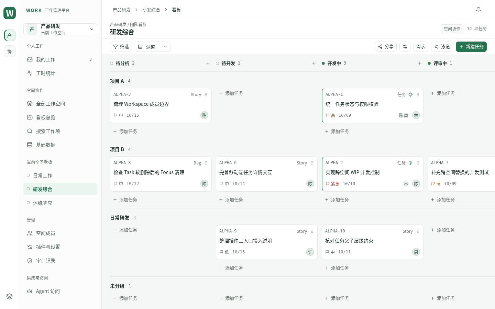

# Work · 工作管理平台

面向团队的工作管理平台，将多工作空间、看板协作与个人 WIP（在制任务）管理放在同一个工作台中。使用飞书账号登录，数据存储在 CloudBase 国内站 PostgreSQL，支持研发与运维场景扩展。

**本地开发需要 Node.js、pnpm、飞书配置及可连接的 CloudBase PostgreSQL。** `pnpm dev` 会检查配置、应用数据库迁移，并同时启动前后端。

[快速开始](#快速开始) · [Agent 接入](docs/agent-access.md) · [环境变量](#环境变量) · [开发与测试](#开发与测试) · [项目结构](#项目结构) · [部署说明](docs/deployment.md) · [CloudBase 迁移](docs/cloudbase-migration.md)



## 核心功能

- **团队协作**：多工作空间、看板、状态、泳道、任务类型、里程碑、标签、评论、资源与活动记录。
- **任务组织**：三层父子任务、单一负责人、多个参与人，以及按分组与参与人筛选的看板视图。
- **工时管理**：按斐波那契档位估算天数，按日期登记实际投入与工作说明，跨任务按人员、日期和任务统计，并对比预估与累计工时。
- **个人工作管理**：跨工作空间的 My Work、全局 WIP 上限、Focus / Unfocus，以及达到上限后的任务替换。
- **访问控制**：工作空间与看板角色、受限看板、账号停用、成员撤权、审计与最后一位有效 Owner 保护。
- **Agent 协作**：CLI、能力清单与配套 skill；人通过飞书登录后明确授权单个工作空间、读写范围和有效期，随时撤销。Agent 的查询和修改持续受该用户当前权限约束，并关联审计记录。
- **基础数据**：工作空间统一维护系统和项目，研发任务关联系统与项目，运维任务复用系统并记录严重程度与事件属性。
- **公开分享**：看板管理员可开启、关闭或重置只读分享链接。研发与运维公开页分别提供需求、工单提报入口，访客提报由内部受理后转为任务。
- **交互体验**：任务快捷预览与完整详情、搜索、通知、Intake、移动端布局与长列表虚拟化。

技术栈：TypeScript、React 19、Vite、TanStack Router / Query、Fastify、PostgreSQL、pnpm workspace。认证由服务端飞书 OAuth 与 HttpOnly Session Cookie 提供；浏览器仅访问同源 API。

### Agent 与 CLI

启动应用并应用迁移后，在仓库根目录运行：

```bash
pnpm work auth login --server http://localhost:5173 --name "任务助手"
# 人在 CLI 给出的链接中使用飞书登录，确认工作空间与授权范围
pnpm work schema
pnpm work boards list
pnpm work tasks list --limit 50
```

默认只读；需要维护任务时，登录命令增加 `--write`，并由人在浏览器明确允许。授权默认 1 小时、最长 12 小时，不自动续期。Web 的“Agent 访问”页面提供授权管理。更新和删除要求任务版本，创建要求稳定的 `clientMutationId`，列表提供有界分页。

使用 `pnpm build:cli` 生成独立 CLI，并将 [work-platform skill](skills/work-platform/SKILL.md) 安装到 Agent 的技能目录。完整命令、授权流程和权限边界见 [Agent 接入文档](docs/agent-access.md)。

### Task 预估与工时

创建任务或打开任务详情时，可以选择 **1、2、3、5、8、13、21、34、55、89 天**，也可以保留“未估算”。这些是以工作天数表达的斐波那契估算档位，不是无单位的故事点；较大任务建议拆分。

任务详情中的“工时记录”支持填写实际工作日期、整数小时和简要说明。日期以北京时间为准，可补录历史日期，不能填写未来日期；每人每天跨所有任务累计最多 24 小时。有任务编辑权限的成员可以记录自己的投入，并修改、删除自己的记录。日志归属记录人，不随后续负责人或参与人变化；修改与删除会保留任务动态，重复提交同一请求不会重复记账。

导航中的“工时统计”可按工作空间、人员、任务和日期区间筛选，查看按人员、日期及任务的汇总。仅统计当前可见任务，已完成任务仍可补录；删除任务、归档看板或失去访问权限后，该任务不会出现在当前统计中。日志仍保留在数据库中。预估对比和人天换算统一按 **1 天 = 8 小时**；投入比例只表示工时消耗，不代表任务完成进度。

## 快速开始

### 1. 准备开发环境

- Node.js **22.13+**（推荐 24 LTS）。
- pnpm **11.19.0**，与 `packageManager` 及锁文件保持一致。
- 一个用于开发的 [CloudBase 国内站环境](https://tcb.cloud.tencent.com/)，已开通 **独享 PostgreSQL**，并且 API / 开发机器可以访问其数据库私网地址。共享 PostgreSQL 不提供本项目所需的 TCP 连接。
- 一个可用的 [飞书企业自建应用](https://open.feishu.cn/app)。

在仓库根目录执行：

```bash
pnpm install --frozen-lockfile
pnpm setup
```

`pnpm setup` 创建根目录 `.env` 并生成随机 Session 密钥。重复执行会保留已有配置；缺少密钥时会自动补齐。

### 2. 填写飞书与 CloudBase 配置

编辑 `.env`，必填下面 **3 项**。首次使用再填写管理员 open_id，即可登录后创建工作空间。

```dotenv
DATABASE_URL=CloudBase 控制台提供的 PostgreSQL 连接串
FEISHU_APP_ID=cli_你的应用 ID
FEISHU_APP_SECRET=你的应用密钥
BOOTSTRAP_PLATFORM_ADMIN_FEISHU_ID=ou_管理员的 open_id
```

**CloudBase**：确认环境属于国内站且已开通独享 PostgreSQL，从控制台数据库连接页取得实际主机、端口、数据库、用户名和密码，组成 `postgresql://` URI。密码中的 `@`、`#`、`%` 等字符需要 URL 编码。EnvId 不能直接拼成数据库地址。API 部署在数据库同地域、同 VPC 的计算环境；本地调试需要已配置的私网接入。地域、VPC、端口和安全组以目标数据库实际信息为准。

按照控制台提供的 TLS 与 CA 要求配置连接，启用 TLS 时完整验证证书；需要自定义 CA 时设置 `DATABASE_CA_CERT_FILE=/安全路径/ca.pem`。生产密钥保存在运行环境的密钥管理中，不提交 `.env` 或证书私钥。

项目通过服务端 `pg` 驱动直接连接数据库，使用有建表、函数与扩展权限的数据库账号。飞书登录和应用权限仍由 API 管理，不需要浏览器数据库凭据或 CloudBase Auth 登录。启动会把仓库迁移应用到目标库，请使用独立开发数据库。旧 `SUPABASE_DB_URL` 仅作为兼容回退；设置 `DATABASE_URL` 后始终优先使用它。已有 Supabase 数据按 [迁移指南](docs/cloudbase-migration.md) 备份和迁入，不能只改地址。

**飞书**：在企业自建应用中启用网页登录能力，配置下列 OAuth 重定向地址，授权获取登录用户信息，并确保应用已发布且当前账号在可用范围内：

```text
http://localhost:5173/auth/feishu/callback
```

管理员变量使用**当前飞书应用下的 open_id**，不是 user_id 或 union_id。可以通过飞书 API 调试工具获取。若尚未取得，先登录，再通过目标数据库 SQL 编辑器查询：

```sql
select feishu_open_id, display_name from public.app_user;
```

将自己的 open_id 填入 `.env`，重启 `pnpm dev` 并重新登录即可获得管理员身份。已引导的管理员不会因移除变量而被降权。

### 3. 启动调试

```bash
pnpm dev
```

打开 **http://localhost:5173**，选择“使用飞书登录”。管理员可在“工作空间”页面创建空间与看板，开始添加任务。

启动会自动检查必要配置并执行尚未应用的迁移，然后在同一终端启动 API 与 Web。数据库不通或迁移失败时会停止启动并显示错误。再次启动会跳过已执行的迁移，**不会重置数据库或导入演示用户**。按 `Ctrl+C` 停止服务；修改 `.env` 后重新启动。

## 环境变量

配置统一放在仓库根目录 `.env`；系统环境变量优先。可用 `ENV_FILE` 指定其他文件，相对路径按仓库根目录解析。

| 变量                                 | 必填         | 用途 / 默认值                                                                  |
| ------------------------------------ | ------------ | ------------------------------------------------------------------------------ |
| `DATABASE_URL`                       | 是           | 服务端 CloudBase PostgreSQL TCP 连接串；API 需具备私网可达性                   |
| `DATABASE_CA_CERT_FILE`              | 否           | 自定义数据库 CA 文件路径，启用 TLS 并完整验证证书                              |
| `SUPABASE_DB_URL`                    | 兼容旧配置   | 仅在未设置 `DATABASE_URL` 时使用，用于迁移过渡和回滚                           |
| `FEISHU_APP_ID`                      | 是           | 飞书企业自建应用 App ID                                                        |
| `FEISHU_APP_SECRET`                  | 是           | 飞书企业自建应用 App Secret                                                    |
| `BOOTSTRAP_PLATFORM_ADMIN_FEISHU_ID` | 首次使用建议 | 指定应用内管理员 open_id，登录时引导管理员身份                                 |
| `APP_SESSION_SECRET`                 | 自动生成     | `pnpm setup` / `pnpm dev` 生成并保存；生产须显式提供至少 32 字符的独立随机密钥 |
| `APP_BASE_URL`                       | 否           | 默认 `http://localhost:5173`，OAuth 回调与请求 Origin 的基准                   |
| `API_PORT`                           | 否           | 默认 `3001`，Web 开发代理自动跟随                                              |
| `TRUSTED_PROXY_CIDRS`                | 否           | 逗号分隔的受信任代理 IP/CIDR，用于解析访客 IP；默认不信任代理头                |
| `NODE_ENV`                           | 否           | 默认 `development`，生产设为 `production`                                      |
| `SENTRY_DSN`                         | 否           | API 错误监控                                                                   |
| `VITE_SENTRY_DSN`                    | 否           | Web 错误监控                                                                   |
| `FEISHU_BASE_URL`                    | 否           | 仅隔离测试中使用模拟飞书，默认留空，生产禁止设置                               |

`.env` 已被 Git 忽略。数据库密码、飞书密钥与 Session 密钥只在服务端使用，不要为其添加 `VITE_` 前缀。

## 开发与测试

### 常用命令

| 命令                            | 作用                                     |
| ------------------------------- | ---------------------------------------- |
| `pnpm setup`                    | 初始化本地配置与 Session 密钥            |
| `pnpm dev`                      | 配置检查 → 数据库迁移 → 启动前后端       |
| `pnpm dev:api` / `pnpm dev:web` | 单独启动 API / Web；自行先执行迁移       |
| `pnpm db:check`                 | 只读检查数据库版本、扩展、权限与迁移历史 |
| `pnpm db:migrate`               | 仅执行待应用的迁移                       |
| `pnpm lint` / `pnpm typecheck`  | 代码规范与 TypeScript 检查               |
| `pnpm test:unit`                | 不依赖数据库的配置、任务队列与 CLI 测试  |
| `pnpm test` / `pnpm test:db`    | API 集成测试 / pgTAP 数据库约束测试      |
| `pnpm test:e2e`                 | Playwright 浏览器测试                    |
| `pnpm build`                    | 构建 Web、API 与 CLI                     |
| `pnpm work` / `pnpm build:cli`  | 运行 CLI 源码 / 构建独立 CLI             |
| `pnpm check:secrets`            | 检查 Web 构建产物是否包含服务端密钥引用  |

### 隔离集成测试

日常开发使用飞书与 CloudBase 独享 PostgreSQL。完整集成测试使用 Fake Feishu、演示账号与**可丢弃的本机 PostgreSQL 15+ 数据库**，数据库还需安装 `pgTAP`。这套测试环境与日常调试分开配置：

```bash
cp tests/.env.example .env.test
# 将 .env.test 中的连接串改为自己的本机测试数据库
ENV_FILE=.env.test pnpm db:reset
ENV_FILE=.env.test pnpm test:db
ENV_FILE=.env.test pnpm test
pnpm exec playwright install --with-deps chromium
ENV_FILE=.env.test pnpm test:e2e
```

Windows PowerShell 使用 `$env:ENV_FILE=".env.test"`，再运行对应命令。Playwright 会自动启动 API、Web 与 Fake Feishu。GitHub Actions 使用原生 PostgreSQL 与 pgTAP，无需 Docker 配置。

`db:reset` 会删除并重建 `public` schema，E2E setup 也会执行 reset。`db:reset` 与 `db:seed` 仅允许回环地址，不能指向需要保留数据的数据库。CloudBase 等远端数据库调试使用 `pnpm dev` 或 `pnpm db:migrate`。

截图基线使用 Linux Chromium；更换系统、字体或浏览器版本后需人工复核差异，再决定是否执行 `pnpm test:e2e --update-snapshots`。已有 Chromium 的环境可通过 `CHROMIUM_PATH` 指定可执行文件。

## 项目结构

```text
apps/
  api/                 Fastify API、飞书认证、Session、数据库访问与插件装配
  web/                 React 工作台、路由、任务交互与插件界面
packages/
  shared/              共享类型、校验与错误码
  cli/                 人授权的 Agent CLI，JSON 输出与版本校验
  plugin-sdk/          插件接口与 Core 模板
  plugin-rnd/          研发插件
  plugin-ops/          运维插件
supabase/
  migrations/          按文件顺序执行的 PostgreSQL 迁移（保留历史目录名）
  tests/               pgTAP 数据库测试
  seed.sql             隔离测试演示数据
scripts/               本地初始化、启动、迁移、构建与校验
tests/                单元、API 集成与 Playwright 测试
docs/                 部署、设计决策与验证记录
skills/work-platform/ Agent 接入 skill 与操作规范
```

## 常见问题

- **启动提示缺少变量**：运行 `pnpm setup`，填写根目录 `.env` 的 3 项必填配置；不要把服务端配置放在 `apps/web/.env`。
- **CloudBase 连接失败**：先确认实例是独享 PostgreSQL。核对控制台实际连接地址、数据库与账号、TLS 证书，以及 API 到数据库私网的 VPC / VPN 路由和安全组；共享实例不能通过调整地址或安全组获得 TCP 连接。
- **迁移找不到数据库扩展函数**：连接统一使用 `search_path=public,extensions`，兼容历史数据库安装在 `extensions` schema 的扩展；确认数据库账号拥有建表与创建扩展权限。
- **飞书回调失败**：核对应用发布状态、用户范围、登录用户信息权限，以及回调白名单是否与启动输出完全一致。`localhost` 与 `127.0.0.1` 不能混用。
- **登录后看不到工作空间**：新数据库没有演示数据。配置管理员 open_id 后重新登录，由管理员创建空间或邀请成员。
- **5173 端口占用**：停止占用进程，或设置 `APP_BASE_URL=http://localhost:5180` 并同步更新飞书回调白名单。开发服务器启用严格端口检查，避免悄悄换端口导致登录失败。

## 部署与贡献

生产构建、数据库权限、TLS 与 HTTPS 反向代理说明见 [部署文档](docs/deployment.md)。本地 Session 密钥不要直接复用于生产。

提交改动前建议运行 `pnpm lint`、`pnpm typecheck` 与相关测试；新增数据库行为请添加新的迁移文件，不要修改已应用的迁移。插件接口与权限约束的背景见 [实施决策](docs/decisions.md)。

现有验证记录见 [验证文档](docs/verification.md)。真实飞书与 CloudBase 国内站的端到端联调需要目标应用、完整 EnvId / 地域、数据库凭据和网络访问；历史本地测试结果不代表外部服务已验证。
