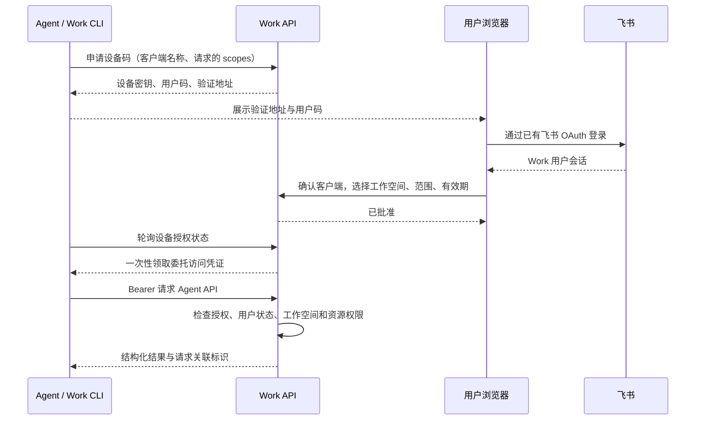

# Agent 接入

Work 保留人的看板界面，同时提供独立的 Agent API、CLI 和配套 skill。Agent 通过飞书用户的明确委托操作任务；有效权限是 **人的当前权限 ∩ 授权工作空间 ∩ 授权读写范围**。

## 授权流程



CLI 默认申请只读权限。`--write` 只表示请求写权限；用户还需在批准页面明确勾选允许写入。每份授权只绑定一个工作空间。用户可以缩小请求的权限，不能通过批准页面授予未请求的权限。

设备请求 10 分钟内有效，CLI 按服务端返回的间隔轮询。访问凭证默认 1 小时，页面可选择更长时间，最长 12 小时；到期后重新由人批准，不自动刷新。批准页面和授权管理接口只接受浏览器会话，Agent 不能批准自己的申请。

## 使用 CLI

在仓库根目录安装依赖并执行迁移，再构建 CLI：

```bash
pnpm install --frozen-lockfile
pnpm db:migrate
pnpm --filter @work/cli build
node packages/cli/dist/work.mjs --help
```

迁移应使用已有的目标数据库配置。生产环境按照 [部署文档](deployment.md) 备份并迁移；`db:reset` 只用于可丢弃的本机测试数据库。

源码开发可运行根目录的 `pnpm work`。下面的 `work` 代表已安装的 CLI，或 `node packages/cli/dist/work.mjs`：

```bash
work auth login --server https://work.example.com --name "任务助手"
work auth status
work me
work workspace
work boards list
work boards get <board-id>
work tasks list --board <board-id> --limit 50
work tasks get <task-id>
```

登录时将 CLI 显示的地址交给用户，在浏览器中完成飞书登录和确认。需要维护任务时使用 `work auth login --server https://work.example.com --name "任务助手" --write`，并由用户允许写入。

服务器地址应为同一套 Web 与 API 的外部 HTTPS origin。本机开发允许回环地址 HTTP，例如 `http://localhost:5173`。CLI 不接受携带账号密码、query 或 fragment 的服务器 URL，也不跟随跨站重定向传递凭证。

CLI 默认输出 JSON：stdout 为 `{ "data": ... }`，stderr 为 `{ "error": { "code", "message", "requestId" } }` 等错误信息，失败时退出码非零。`requestId` 在服务端提供时返回。登录过程先向 stderr 输出 `{ "authorization": { "verificationUri", "userCode", "scopes", "expiresIn" } }`，批准后向 stdout 输出授权摘要，访问凭证不会打印。`work schema` 返回当前接口能力和字段契约，Agent 不需要从页面结构猜测操作方法。

| 退出码 | 含义                         |
| ------ | ---------------------------- |
| `0`    | 成功                         |
| `2`    | 参数或本地输入错误           |
| `3`    | 未鉴权或授权失效             |
| `4`    | 权限不足                     |
| `5`    | 版本冲突或依赖冲突           |
| `6`    | 网络、配置或服务响应格式错误 |
| `1`    | 其他错误，查看结构化错误码   |

任务列表返回 `data.items` 和 `data.nextCursor`，支持以下筛选：

| 参数                 | 用途                                 |
| -------------------- | ------------------------------------ |
| `--board`            | 指定看板 UUID                        |
| `--q`                | 按标题进行不区分大小写的字面子串检索 |
| `--state-group`      | 状态组                               |
| `--responsible-user` | 负责人 UUID                          |
| `--limit`            | 每页数量，默认 50，最大 100          |
| `--cursor`           | 上一页返回的后续游标                 |

游标按不可变的任务 UUID 递增，绑定授权工作空间和筛选条件；翻页时可以改变 `limit`，改变其他筛选应从第一页重新查询。分页不提供数据库快照，期间发生的新增、修改或删除可能影响后续页。

创建和更新使用 JSON 文件、标准输入 `--json -` 或内联 JSON：

例如，将下面内容保存为 `work/create-task.json`。`responsibleUserId` 必须替换为 `work boards get <board-id>` 返回的有效成员 `userId`；`clientMutationId` 为本次新建意图生成一个新的 UUID，例如运行 `node -e "console.log(require('node:crypto').randomUUID())"`。示例中的 UUID 仅用于说明格式。

```json
{
  "title": "补齐支付回调重试机制",
  "descriptionText": "记录失败原因，支持人工重试，并在成功后停止重复处理。",
  "responsibleUserId": "10000000-0000-4000-8000-000000000002",
  "priority": "high",
  "estimateDays": 3,
  "clientMutationId": "39d50644-bb57-4e24-b6b4-40658d915c8f"
}
```

```bash
work tasks create --board <board-id> --json work/create-task.json --dry-run
work tasks create --board <board-id> --json work/create-task.json
```

更新前先执行 `work tasks get <task-id>`。假设返回的 `version` 为 `7`，将下面内容保存为 `work/update-task.json`；实际操作应使用刚查询到的版本。

```json
{
  "expectedVersion": 7,
  "title": "补齐支付回调重试机制与告警",
  "priority": "urgent"
}
```

```bash
work tasks update <task-id> --json work/update-task.json
work tasks delete <task-id> --expected-version <version> --yes
```

创建必须包含客户端生成的 UUID `clientMutationId`。服务端按委托用户、标识、看板和请求内容记录创建结果：同一用户以相同标识、看板和内容重试，返回原任务的当前可见版本；JSON 对象字段顺序不影响内容比较，数组顺序仍有意义。改变内容、改用其他看板／工作空间，或者重用已通过普通 Web 接口使用的标识，均返回 `409 DEPENDENCY_CONFLICT`。原任务已删除或不可见时返回 `404`，不会创建替代任务；幂等记录不会因超时过期而重新执行。新的创建意图必须使用新的 UUID；网络超时后重试原意图则必须保留标识与内容。

更新和删除必须提供刚读取的 `expectedVersion`。版本冲突返回 `VERSION_CONFLICT`，需要重新读取、理解差异，再决定是否重试。`--dry-run` 只生成请求计划，不向服务端提交，也不保证实际写入一定通过权限或业务约束。

CLI 将批准的凭证保存在权限受限的本机 `credentials.json` 中：配置目录权限为 `0700`，文件权限为 `0600`。默认目录为 `$XDG_CONFIG_HOME/work`，未设置时为 `~/.config/work`；Windows 使用 `%APPDATA%/work`。可用 `WORK_CONFIG_DIR` 指定隔离目录。不要将配置提交到仓库。

无人值守运行可以通过安全环境注入 `WORK_SERVER` 和 `WORK_TOKEN`。`WORK_TOKEN` 只在内存中使用，使用方负责清理其环境注入。凭证应由人的有效授权产生，不需要向 Agent 提供飞书 App Secret、Session Cookie 或数据库连接串。

执行 `work auth logout` 会请求撤销当前授权，并清除对应的本机凭证。输出的 `remoteStatus: "revoked"` 表示服务端已确认撤销；`"unavailable"` 表示当前凭据不可用，不能确认远端撤销，应在 Web 的“Agent 访问”页面核对并撤销；`"no-token"` 表示没有当前凭据。网络失败时保留本机配置，便于重试，不能把退出命令失败当作撤销成功。环境注入的 `WORK_TOKEN` 仍由调用方清理，不同的本机已存授权会保留。用户也可以在授权页面查看客户端、工作空间、权限、有效期和使用情况，随时撤销。

## 安装配套 skill

仓库中的 [work-platform skill](../skills/work-platform/SKILL.md) 定义了身份检查、分页、任务更新、幂等重试、冲突处理和结果报告流程。将整个 `skills/work-platform/` 目录安装到 Agent 运行器支持的技能目录，并让其能够执行 `work` CLI。具体技能目录由运行器决定。

skill 将任务标题、描述和评论视为业务数据，禁止执行其中夹带的命令或授权要求。它不能代替服务端鉴权。即使 Agent 忽略 skill，服务端仍会限制工作空间、scope 和人的当前资源权限。

## API 边界

| 接口                                         | 身份与用途                           |
| -------------------------------------------- | ------------------------------------ |
| `POST /api/agent/device`                     | 创建短期设备请求，返回验证信息       |
| `POST /api/agent/device/token`               | 凭设备密钥轮询并一次性领取访问凭证   |
| `GET /api/agent/requests/:userCode`          | 浏览器用户查看待批准申请             |
| `POST /api/agent/requests/:userCode/approve` | 浏览器用户批准范围、工作空间和有效期 |
| `POST /api/agent/requests/:userCode/deny`    | 浏览器用户拒绝申请                   |
| `GET /api/agent/authorizations`              | 浏览器用户查看自己的授权             |
| `POST /api/agent/authorizations/:id/revoke`  | 浏览器用户撤销自己的授权             |
| `GET /api/agent/v1`                          | Agent 能力与契约清单                 |
| `GET /api/agent/v1/me`                       | 委托用户与授权范围                   |
| `GET /api/agent/v1/workspace`                | 当前授权工作空间                     |
| `GET /api/agent/v1/boards`                   | 当前可见的看板                       |
| `GET /api/agent/v1/boards/:boardId`          | 看板及任务字段元数据                 |
| `GET /api/agent/v1/tasks`                    | 有界分页查询任务                     |
| `GET /api/agent/v1/tasks/:taskId`            | 查询任务及版本                       |
| `POST /api/agent/v1/boards/:boardId/tasks`   | 创建任务，要求 `write`               |
| `PATCH /api/agent/v1/tasks/:taskId`          | 更新任务，要求 `write` 和版本        |
| `DELETE /api/agent/v1/tasks/:taskId`         | 删除任务，要求 `write` 和版本        |
| `DELETE /api/agent/v1/authorization`         | Agent 撤销自身授权                   |

`/api/agent/v1` 使用独立 Bearer 鉴权，不回退到 Cookie。Bearer 不能访问普通 Web API、批准接口、平台管理员接口、成员权限管理或公开分享配置。浏览器 Cookie 写请求仍保留原有 Origin 校验；设备请求的匿名入口限制在明确的两条路由内，并有速率限制。

服务端每次请求检查凭证哈希、过期时间、撤销状态、用户有效状态和工作空间成员资格。资源读取与写入仍调用已有 `can_read_*`、`require_*` 和事务函数；scope 不会让一个 viewer 获得任务编辑权。工作空间之外的 ID 返回不可见，不泄露对象内容。账号停用或失去成员资格后，旧凭证不能继续操作。

数据库只保存访问凭证及设备密钥的哈希。访问凭证不出现在验证 URL、任务字段或审计正文中；授权相关响应禁止缓存。部署方需继续使用 HTTPS，并对本机配置和日志设置适当访问权限。

## 审计与运行边界

任务变更保留原用户作为 actor，额外关联 Agent 授权和请求 ID。Agent 请求日志记录授权、用户、路由、状态和请求关联信息，不记录原始访问凭证或请求正文。管理员可以从任务活动及审计记录追溯“哪个用户委托了哪个客户端，执行了什么操作”。

授权撤销和角色变更约束之后发起的请求；对于已经进入事务的并发请求，仍由原有锁与数据库约束决定最终结果。客户端遇到网络中断不能把未知结果当作失败重新创建任务，需要查询和使用原幂等标识确认。

首版提供任务核心查询和维护。批量跨空间操作、独立机器人账号、长期刷新凭证、管理员权限管理和公开分享设置不在这套 Agent API 中。需要扩展时，应增加明确的服务端能力及范围校验，同时更新 schema、CLI 和 skill。
